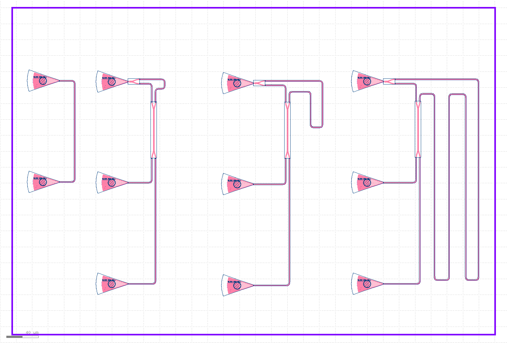
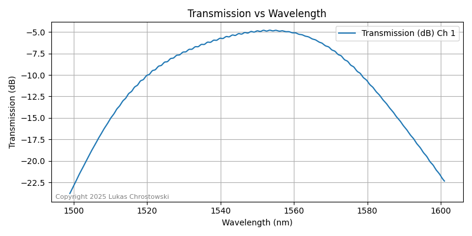
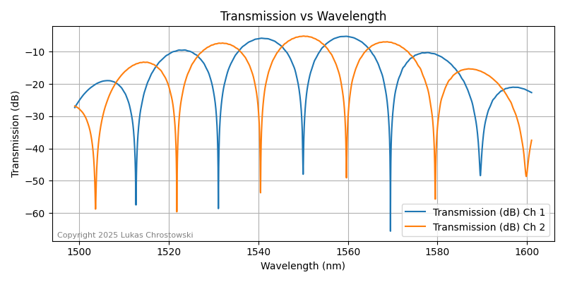
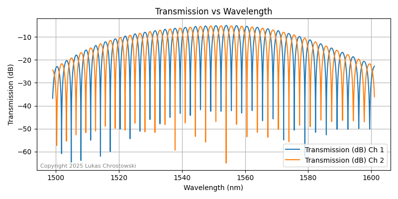
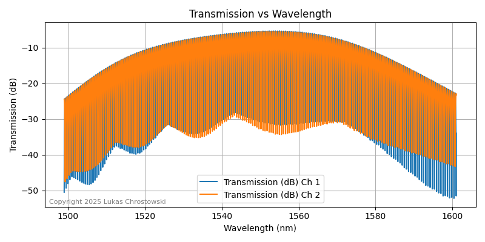

[README.md](https://github.com/user-attachments/files/34211870/README.md)
# Mach–Zehnder Interferometer (MZI) Design in KLayout

Three silicon photonic Mach–Zehnder interferometer test circuits with different arm lengths and a grating coupler loopback reference. Designed in KLayout with the SiEPIC EBeam PDK and simulated with SiEPIC-Tools.

**Status:** design and simulation. The circuits have not been fabricated or measured.

)

## Purpose

To design and simulate Mach–Zehnder interferometer test circuits with different arm length differences, together with a grating coupler loopback for loss calibration, using KLayout and the SiEPIC EBeam PDK. The devices carry standard `opt_in` labels so they can be measured automatically. The aim is to learn the silicon photonic design flow and to see how the arm length difference sets the spacing of the spectral peaks.

## Background

A Mach–Zehnder interferometer splits light into two waveguide arms and recombines it. The output depends on the path length difference (ΔL) between the arms, so it is a basic building block for filters, modulators and sensors. The spacing between neighbouring peaks, the free spectral range (FSR), is approximately:

```
FSR ≈ λ² / (n_g × ΔL)
```

where λ is the wavelength and n_g is the group index of the waveguide. A longer ΔL gives peaks that are closer together.

All devices use the standard label format `opt_in_TE_1550_device_<name>` (TE polarisation near 1550 nm).

Components used: ebeam_gc_te1550 (TE 1550 nm grating coupler), ebeam_y_1550 (Y-junction optical splitter) and ebeam_bdc_te1550 (Broadband directional coupler (50:50)).

## Simulation

Circuit simulations were run for all four labelled devices using SiEPIC-Tools with the SiEPIC EBeam PDK, and each run completed without an error message.

To see the simulation results, check the following images:

### Loopback Reference


### MZI 1


### MZI 2


### MZI 3


## Repository contents

```
mzi-klayout/
├── README.md          Overview, devices and results (this file)
├── BUILD_GUIDE.md     Step-by-step guide to build a similar design
└── images/            Layout screenshots and simulation plots
```

The layout file itself is published here the same repository in Design folder. If you have questions about the design, please contact me.

## Tools

- KLayout
- SiEPIC-Tools
- SiEPIC EBeam PDK

## Credits

Built with the open-source SiEPIC tools and EBeam PDK from the SiEPIC community: https://github.com/SiEPIC

## Author

Mohammad Ullah, Electrical and Electronic Engineering, RUET
Portfolio: https://mohammadullah2eee.github.io
